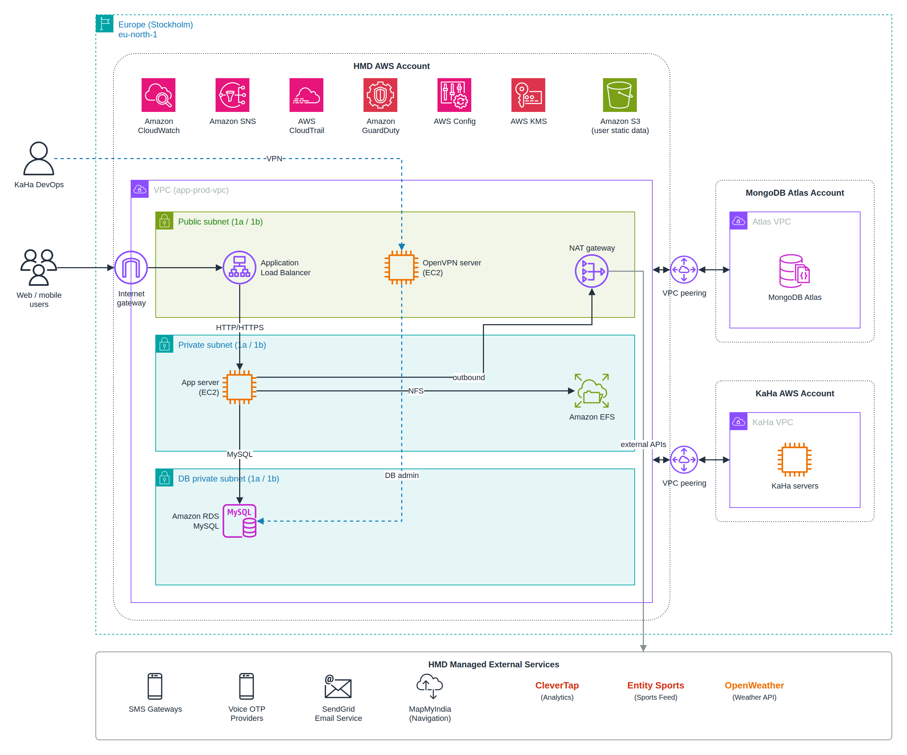

# HMD AWS infrastructure (eu-north-1, Stockholm)

Record of the production environment in the **HMD AWS account**.
The environment was built manually in the AWS console. This repo documents it as
Terraform code plus a written description. KaHa account resources are not included,
apart from the HMD side of the VPC peering.

Details: [docs/architecture.md](docs/architecture.md)

> **Documentation only.** These resources already exist. Do not run `terraform apply`
> against the HMD account: it would try to create a second copy of everything.

IP ranges, resource IDs, account IDs, bucket names and email addresses are not stored
in this repo. The code reads them from variables, and `terraform.tfvars.example`
contains placeholders only.

## Contents

| Path | Describes |
|---|---|
| `docs/architecture.md` | Architecture diagram, design considerations, resource details |
| `docs/architecture.png` | Architecture diagram (AWS icons) |
| `docs/architecture.drawio` | Editable draw.io source of the diagram |
| `vpc.tf` | VPC, 6 subnets, internet gateway, NAT gateway, route tables |
| `vpc_peering.tf` | HMD side of the peering with the KaHa VPC and the MongoDB Atlas VPC |
| `security_groups.tf` | ALB, app server, EFS, DB and OpenVPN security groups |
| `kms.tf` | KMS key (symmetric, single region) |
| `cloudtrail.tf` | Multi-region trail with S3 and CloudWatch Logs delivery |
| `alb.tf` | Internet-facing Application Load Balancer |
| `efs.tf` | Regional EFS for the app servers |
| `iam.tf` | EC2 instance role |
| `ec2.tf`, `user_data/app-server.sh` | App server and its base AMI |
| `s3.tf` | User static data bucket |
| `rds.tf` | RDS MySQL |
| `monitoring.tf` | SNS alerts topic and CloudWatch alarms |
| `guardduty.tf` | GuardDuty |
| `config.tf` | AWS Config |
| `openvpn.tf` | OpenVPN server used by KaHa DevOps |
| `variables.tf`, `terraform.tfvars.example`, `outputs.tf` | Inputs and outputs of the code |

## Note on the code

Settings the design document doesn't mention (RDS engine version, alarm thresholds,
encryption options and similar) are typical values and may differ from what is
configured in the console. The console is the source of truth.
